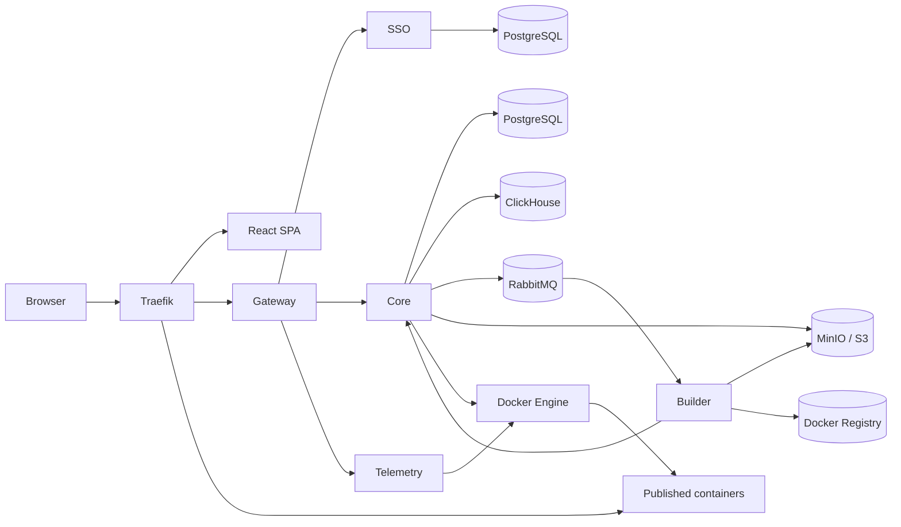

<div align="center">

# Docker Cloud Manager

**A self-hosted PaaS for running and managing containerized applications on a single server**

[](#project-status)
[](backend/go.mod)
[](frontend/package.json)
[](docker-compose.yml)
[](LICENSE)

[Русский](README.md) · **English**

</div>

Docker Cloud Manager (DCM) is an open-source, Heroku- and Railway-style platform for developers and small teams. It runs containers, Docker Compose projects, and custom images without giving users direct shell access to the server.

> [!IMPORTANT]
> The project is in development and is not yet intended for production workloads. The current single-VM deployment uses HTTP; HTTPS/ACME is not configured yet.

## Table of contents

- [Features](#features)
- [Architecture](#architecture)
- [Technology stack](#technology-stack)
- [Quick start](#quick-start)
- [Development](#development)
- [Repository structure](#repository-structure)
- [Operations and security](#operations-and-security)
- [Documentation](#documentation)
- [Project status](#project-status)
- [License](#license)

## Features

### For users

- Run standalone containers from public Docker Hub images.
- Build custom images from `.zip`, `.tar.gz`, or public HTTPS Git repositories.
- Deploy multi-container applications with Docker Compose from a YAML file, archive, or Git repository.
- Manage persistent Docker volumes, including attaching DCM volumes as `external: true` in Compose.
- Publish applications on custom subdomains through Traefik.
- View CPU, memory, and network statistics, build logs, and real-time container logs.
- Open a browser terminal for running containers through single-use stream tickets.
- Use an isolated Docker network for each user.

### For administrators

- Manage users, roles, statuses, and quotas.
- Manage resources across all users.
- Monitor server load, available capacity, and admission control.
- Review resource usage reports and audit events.
- Change runtime settings without restarting services.

## Architecture



| Component | Responsibility |
| --- | --- |
| **Gateway** | HTTP edge/API gateway, request authentication, authorization, and stream proxying |
| **SSO** | Users, roles, tokens, permissions, quotas, and OIDC identity binding |
| **Core** | Docker orchestration, resource state, admission control, Compose, builds, reports, and audit |
| **Builder** | RabbitMQ worker that builds custom images with Kaniko |
| **Telemetry** | Internal-only service for container logs and browser terminals |
| **Frontend** | React SPA for the user and administration panels |

Long-running lifecycle operations execute asynchronously through durable database state and RabbitMQ queues. PostgreSQL remains the source of truth for users and runtime resources, while ClickHouse serves as the analytical read model.

## Technology stack

| Area | Stack |
| --- | --- |
| Backend | Go, Gin, gRPC, Protocol Buffers |
| Frontend | React 19, TypeScript, Vite, Tailwind CSS |
| Frontend state | TanStack Query, Zustand |
| Data | PostgreSQL, ClickHouse |
| Queues and objects | RabbitMQ, MinIO / S3-compatible storage |
| Containers | Docker Engine API, Docker Compose, Kaniko, Docker Registry |
| Edge and publishing | Traefik |

## Quick start

### Requirements

- A Linux server with a public IPv4 or IPv6 address.
- Docker Engine and the Docker Compose plugin.
- A user with access to the Docker daemon.
- An available inbound TCP port `80`.
- A panel domain (`DCM_HOST`) and a wildcard DNS record for applications (`*.BASE_DOMAIN`).

The default domain settings use `localhost` for local evaluation. For an externally accessible deployment, point the main and wildcard domains to the server first.

### 1. Clone the repository

```bash
git clone https://github.com/callmerussell04/docker-cloud-manager.git
cd docker-cloud-manager
```

### 2. Create the configuration

```bash
cp backend/.env.example backend/.env
```

Open `backend/.env` and:

- replace every `change_me_*` value with a unique random secret;
- set `SSO_ADMIN_EMAIL` and a secure `SSO_ADMIN_PASSWORD`;
- for an external server, configure `DCM_HOST`, `BASE_DOMAIN`, `FRONTEND_API_URL`, `CORS_ALLOWED_ORIGINS`, and `GATEWAY_AUTH_REDIRECT_ALLOWED_ORIGINS`;
- keep `COOKIE_SECURE=false` only for the current HTTP deployment.

### 3. Validate and start the stack

```bash
docker compose --env-file backend/.env config --quiet
docker compose --env-file backend/.env up -d --build
```

PostgreSQL and ClickHouse migrations run automatically as one-shot services before their dependent components start.

### 4. Check the deployment

```bash
docker compose --env-file backend/.env ps
curl -fsS http://localhost/health/live
curl -fsS http://localhost/health/ready
```

Open `http://<DCM_HOST>/` and sign in with `SSO_ADMIN_USERNAME` and `SSO_ADMIN_PASSWORD` from `backend/.env`.

DNS and Docker address pools are covered in the [single-VM deployment guide](docs/deployment-single-vm.md). For common problems, see the [troubleshooting guide](docs/troubleshooting.md).

## Development

### Backend

Run backend commands from `backend/`:

```bash
cd backend

make verify     # integration-free gates (see below)
make build
make test-fast
make vet
make test-race
make vulncheck
make lint
```

`make verify` runs `check-format` (gofmt over all backend Go files), `check-generated`, `check-tidy` (`go mod tidy -diff`), `build`, `vet`, `check-architecture`, `lint` and `test-race` (the fast suite under the race detector), stopping at the first failing gate. `make test` (Docker-backed integration) and `make vulncheck` (live vulnerability database) run separately. golangci-lint v2.11.4 is installed under ignored `backend/bin/tools/`.

The `Backend` GitHub Actions workflow (`.github/workflows/backend.yml`) runs `make verify`, `make test` and `make vulncheck` as separate jobs on backend pushes and pull requests; a weekly schedule reruns only `make vulncheck`. It has read-only repository permissions, pins actions by commit and protoc 34.1 by checksum, sets job timeouts and prints test service state and logs when integration tests fail before removing the services.

Canonical Make targets select Go **1.26.10** from `backend/go.mod` via `GOTOOLCHAIN`, including on newer hosts; first use may download it. Direct Go commands must use `GOTOOLCHAIN=go1.26.10` for the same compiler. Builds use read-only module metadata, disable CGO, and remove local paths/VCS metadata. `make build` does not format or tidy sources; run `make tidy` explicitly when needed. Scanner: govulncheck v1.9.0; `make vulncheck` (requires `jq`) scans production roots and all five built binaries and fails on any symbol-level finding not accepted in `backend/vulncheck/policy.json`, or on an accepted entry that is no longer reported. See [toolchain and build inputs](docs/deployment-single-vm.md#go-toolchain-and-build-inputs) for pins and scan applicability.

Generation requires Go and `protoc` 34.1 from [protobuf v34.1](https://github.com/protocolbuffers/protobuf/releases/tag/v34.1) on `PATH` (or `make PROTOC=/path/to/protoc ...`). Make installs pinned Go plugins under ignored `backend/bin/tools/`; no global mockery, plugins, or gotestsum installation is needed. Initial use requires access to the Go module proxy.

```bash
make generate-mocks  # mockery v2.53.6; ignored tests/mocks/
make generate-proto  # protoc-gen-go v1.36.11, protoc-gen-go-grpc v1.6.2
make generate        # both
make check-generated # prepare mocks and compare protobuf output without overwriting it
```

Both `make test-fast` and `make test` prepare mocks and reject protobuf drift. After editing a `.proto`, run `make generate-proto` and commit the generated files. The test runner is pinned to gotestsum v1.13.0. Direct `go test` commands require `make generate-mocks` first.

Run the complete integration test suite with temporary infrastructure:

```bash
cd backend
make test
```

Docker Engine and the Compose plugin must be available. The runner provisions PostgreSQL, ClickHouse, RabbitMQ and MinIO on loopback ports defined in `backend/docker-compose.test.yml`, enables Docker smoke tests, and removes test containers, networks and volumes after success or failure, including startup failure. `TEST_KEEP_ENV=1` keeps them for diagnosis; use `make test-env-down` afterward. `TEST_DOCKER_SMOKE=0` explicitly disables Docker smoke coverage. The default startup wait is 120 seconds, package test timeout is five minutes, and shared Core fixture RPCs have a five-second deadline. Full tests run with `-p=1` because PostgreSQL extension setup is shared across schemas.

`DCM_CLICKHOUSE_TEST_DB`, `DCM_CLICKHOUSE_TEST_USER` and `DCM_CLICKHOUSE_TEST_PASSWORD` configure both provisioning and the test client (defaults: `dcm_reports_test`, `dcm_reports_test`, `clickhouse`). `TEST_COMPOSE_PROJECT` isolates Compose resource names; host ports must still be free. Use `TEST_PKGS` to select packages or `TEST_ARGS` / `TEST_ALL_ARGS` to override Go test flags.

### Frontend

```bash
cd frontend
npm ci
VITE_API_URL=http://localhost/api/v1 VITE_BASE_DOMAIN=localhost npm run dev
```

Lint and create a production build:

```bash
cd frontend
npm run lint
npm run build
```

### Full stack

From the repository root:

```bash
docker compose --env-file backend/.env up -d --build
```

## Repository structure

```text
.
├── backend/
│   ├── api/             # OpenAPI and protobuf contracts
│   ├── cmd/             # Service entry points
│   ├── internal/        # Bounded contexts and Clean Architecture layers
│   ├── migrations/      # PostgreSQL and ClickHouse migrations
│   ├── pkg/             # Shared backend packages
│   └── tests/           # Backend tests
├── frontend/
│   └── src/             # React SPA
├── docs/                # Project and deployment documentation
├── docker-compose.yml   # Complete single-VM stack
└── LICENSE
```

## Operations and security

> [!WARNING]
> `docker compose --env-file backend/.env down -v` deletes the persistent volumes that contain databases, object storage, the registry, and queues. Use `docker compose --env-file backend/.env down` for a normal shutdown.

- The current Compose stack exposes external traffic over HTTP on port `80`. Configure HTTPS and secure cookies separately before production use.
- Docker creates a separate bridge network for every user. Configure `default-address-pools` in the Docker daemon before operating the platform to prevent subnet exhaustion.
- RabbitMQ, MinIO, Registry, and Traefik administration interfaces must not be exposed publicly; the current Compose configuration binds their ports to `127.0.0.1`.
- Data remains in Docker volumes after a regular `docker compose down`.
- Access tokens, refresh cookies, internal service tokens, build arguments, and container environment values must not appear in logs.

## Documentation

- [Documentation index (Russian)](docs/README.md)
- [Single-VM deployment (Russian)](docs/deployment-single-vm.md)
- [User guide (Russian)](docs/user-guide.md)
- [Administrator guide (Russian)](docs/admin-guide.md)
- [Troubleshooting (Russian)](docs/troubleshooting.md)
- [API guide (Russian)](docs/api-guide.md)
- [HTTP API — OpenAPI 3.0](backend/api/gateway/openapi.yml)

## Project status

Docker Cloud Manager is in development. Configuration and API backward compatibility are not guaranteed yet, and the current deployment targets a single server with HTTP traffic. Evaluate the risks, configure HTTPS, and arrange backups before using the project with important data.

## License

This project is licensed under the [Apache License 2.0](LICENSE).
