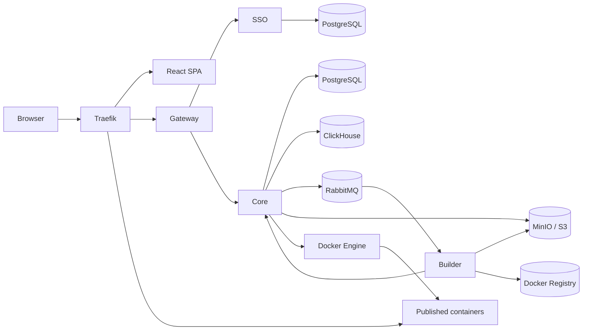

<div align="center">

# Docker Cloud Manager

**A self-hosted PaaS for running and managing containerized applications on a single server**

[](#project-status)
[](backend/go.mod)
[](frontend/package.json)
[](docker-compose.yml)
[](LICENSE)

[Русский](README.md) · **English**

</div>

Docker Cloud Manager (DCM) is an open-source, Heroku- and Railway-style platform for developers and small teams. It runs containers, Docker Compose projects, and custom images without giving users direct shell access to the server.

> [!IMPORTANT]
> The project is in development and is not yet intended for production workloads. The current single-VM deployment uses HTTP; HTTPS/ACME is not configured yet.

## Table of contents

- [Features](#features)
- [Architecture](#architecture)
- [Technology stack](#technology-stack)
- [Quick start](#quick-start)
- [Development](#development)
- [Repository structure](#repository-structure)
- [Operations and security](#operations-and-security)
- [Documentation](#documentation)
- [Project status](#project-status)
- [License](#license)

## Features

### For users

- Run standalone containers from public Docker Hub images.
- Build custom images from `.zip`, `.tar`, `.tar.gz`, or public HTTPS Git repositories.
- Deploy multi-container applications with Docker Compose from a YAML file, archive, or Git repository.
- Manage persistent Docker volumes, including attaching DCM volumes as `external: true` in Compose.
- Publish applications on custom subdomains through Traefik.
- View CPU, memory, and network statistics, build logs, and real-time container logs.
- Open a browser terminal for running containers through single-use stream tickets.
- Use an isolated Docker network for each user.

### For administrators

- Manage users, roles, statuses, and quotas.
- Manage resources across all users.
- Monitor server load, available capacity, and admission control.
- Review resource usage reports and audit events.
- Change runtime settings without restarting services.

## Architecture



| Component | Responsibility |
| --- | --- |
| **Gateway** | HTTP edge/API gateway, request authentication, authorization, and proxying to Core, including log and terminal streams |
| **SSO** | Users, roles, tokens, permissions, and OIDC identity binding |
| **Core** | Docker orchestration, resource state, user quotas, admission control, Compose, builds, container logs and browser terminals, reports, and audit |
| **Builder** | RabbitMQ worker that builds custom images with Kaniko |
| **Frontend** | React SPA for the user and administration panels |

Long-running lifecycle operations execute asynchronously through durable database state and RabbitMQ queues. PostgreSQL remains the source of truth for users and runtime resources, while ClickHouse serves as the analytical read model.

## Technology stack

| Area | Stack |
| --- | --- |
| Backend | Go, Gin, gRPC, Protocol Buffers |
| Frontend | React 19, TypeScript, Vite, Tailwind CSS |
| Frontend state | TanStack Query, Zustand |
| Data | PostgreSQL, ClickHouse |
| Queues and objects | RabbitMQ, MinIO / S3-compatible storage |
| Containers | Docker Engine API, Docker Compose, Kaniko, Docker Registry |
| Edge and publishing | Traefik |

## Quick start

This is the shortest path to a working stack on a personal machine with the `localhost` domain. For an externally reachable server, follow the full [single-VM deployment guide](docs/deployment-single-vm.md) (Russian): it covers DNS, Docker address pools, and certificates from your own CA.

### Requirements

- Linux with Docker Engine 29.5.1 or newer, the Docker Compose plugin, and Docker's iptables backend.
- A user with access to the Docker daemon and `sudo` rights.
- An available inbound TCP port `80`.
- `git` and `openssl`.

### 1. Clone the repository

```bash
git clone https://github.com/callmerussell04/docker-cloud-manager.git
cd docker-cloud-manager
```

### 2. Prepare the kernel

The build network policy needs bridge traffic filtering:

```bash
sudo modprobe br_netfilter
sudo sysctl -w net.bridge.bridge-nf-call-iptables=1 net.bridge.bridge-nf-call-ip6tables=1
```

The deployment guide shows how to keep these settings across reboots.

### 3. Create the configuration

```bash
cp backend/.env.example backend/.env
chmod 600 backend/.env
```

Open `backend/.env` and replace every `change_me_*` value with its own random secret (`openssl rand -hex 32`). `GATEWAY_SERVICE_TOKEN`, `CORE_SERVICE_TOKEN`, and `BUILDER_SERVICE_TOKEN` must differ, and `OBJECT_STORAGE_SECRET_KEY` must equal `MINIO_ROOT_PASSWORD`. Set `SSO_ADMIN_EMAIL` and a strong `SSO_ADMIN_PASSWORD`.

### 4. Create the registry certificates

The internal image registry only speaks TLS. Throwaway certificates are enough for a personal machine:

```bash
cd backend
make dev-certs
cd ..
```

The target (it needs `sudo`) creates the certificates in `/etc/dcm/registry` (the template's `REGISTRY_CERTS_DIR`), installs the CA for Docker, and adds the `registry` name to `/etc/hosts`. Do not use these certificates on a production server.

### 5. Start the stack

```bash
docker compose --env-file backend/.env config --quiet
docker compose --env-file backend/.env up -d --build
```

The first build takes a few minutes. PostgreSQL and ClickHouse migrations run automatically before their dependent services start.

### 6. Check the deployment

```bash
docker compose --env-file backend/.env ps --all
curl -fsS http://localhost/health/live
curl -fsS http://localhost/health/ready
```

Open `http://localhost/` and sign in with `SSO_ADMIN_USERNAME` and `SSO_ADMIN_PASSWORD` from `backend/.env`. If something does not start, see the [troubleshooting guide](docs/troubleshooting.md) (Russian).

## Development

Run backend commands from `backend/` and frontend commands from `frontend/`:

```bash
cd backend
make verify   # formatting, generated code, go mod tidy, build, vet, lint, fast tests under the race detector
make test     # full suite with temporary PostgreSQL, ClickHouse, RabbitMQ and MinIO in Docker
```

```bash
cd frontend
npm ci
VITE_API_URL=http://localhost/api/v1 VITE_BASE_DOMAIN=localhost npm run dev
npm run lint && npm run build && npm test
```

Tooling, code generation, tests, CI, pinned versions, and vulnerability scanning are described in the [developer guide](docs/development.md) (Russian). The frontend layout is described in [`frontend/README.md`](frontend/README.md).

## Repository structure

```text
.
├── backend/
│   ├── api/             # OpenAPI and protobuf contracts
│   ├── cmd/             # Service entry points
│   ├── internal/        # Bounded contexts and shared packages (platform)
│   ├── migrations/      # PostgreSQL and ClickHouse migrations
│   └── tests/integration/ # Multi-module tests; unit tests sit beside their code
├── deployment/registry/ # Registry and build network isolation images and scripts
├── frontend/
│   └── src/             # React SPA
├── docs/                # Project and deployment documentation
├── docker-compose.yml   # Complete single-VM stack
└── LICENSE
```

## Operations and security

> [!WARNING]
> `docker compose --env-file backend/.env down -v` deletes the persistent volumes that contain databases, object storage, the registry, and queues. Use `docker compose --env-file backend/.env down` for a normal shutdown.

- The current Compose stack exposes external traffic over HTTP on port `80`. HTTPS is not supported out of the box; do not keep important data on a server reachable from an untrusted network.
- Docker creates a separate bridge network for every user. Configure `default-address-pools` in the Docker daemon before operating the platform to prevent subnet exhaustion.
- RabbitMQ, MinIO, Registry, and Traefik administration interfaces must not be exposed publicly; the current Compose configuration binds their ports to `127.0.0.1`.
- Data remains in Docker volumes after a regular `docker compose down`. Upgrades and backups are covered in the [operations guide](docs/operations.md) (Russian), and the security model in a [separate document](docs/security-model.md) (Russian).
- Access tokens, refresh cookies, internal service tokens, build arguments, and container environment values must not appear in logs.

## Documentation

- [Documentation index (Russian)](docs/README.md)
- [Single-VM deployment (Russian)](docs/deployment-single-vm.md)
- [Upgrades and backups (Russian)](docs/operations.md)
- [User guide (Russian)](docs/user-guide.md)
- [Administrator guide (Russian)](docs/admin-guide.md)
- [Configuration reference (Russian)](docs/configuration.md)
- [Troubleshooting (Russian)](docs/troubleshooting.md)
- [API guide (Russian)](docs/api-guide.md)
- [Developer guide (Russian)](docs/development.md)
- [HTTP API — OpenAPI 3.0](backend/api/gateway/openapi.yml)

## Project status

Docker Cloud Manager is in development. Configuration and API backward compatibility are not guaranteed yet, and the current deployment targets a single server with HTTP traffic. Evaluate the risks and arrange [backups](docs/operations.md) before using the project with important data.

## License

This project is licensed under the [Apache License 2.0](LICENSE).
