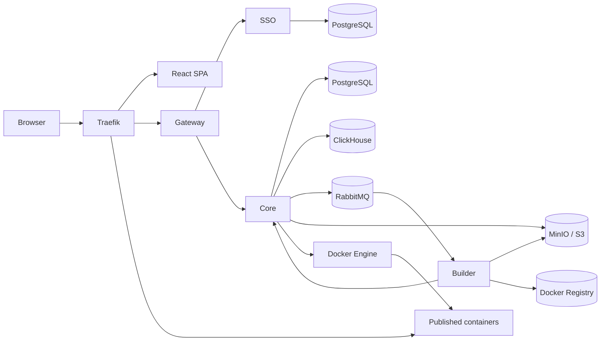

<div align="center">

# Docker Cloud Manager

**Self-hosted PaaS для запуска и управления контейнерными приложениями на одном сервере**

[](#статус-проекта)
[](backend/go.mod)
[](frontend/package.json)
[](docker-compose.yml)
[](LICENSE)

**Русский** · [English](README.en.md)

</div>

Docker Cloud Manager (DCM) — открытая платформа в стиле Heroku и Railway для разработчиков и небольших команд. Она позволяет запускать контейнеры, Docker Compose проекты и собственные образы без прямого shell-доступа к серверу.

> [!IMPORTANT]
> Проект находится в разработке. Текущий single-VM сценарий использует HTTP; HTTPS/ACME ещё не настроены.

## Содержание

- [Возможности](#возможности)
- [Архитектура](#архитектура)
- [Технологии](#технологии)
- [Быстрый старт](#быстрый-старт)
- [Разработка](#разработка)
- [Структура репозитория](#структура-репозитория)
- [Эксплуатация и безопасность](#эксплуатация-и-безопасность)
- [Документация](#документация)
- [Статус проекта](#статус-проекта)
- [Лицензия](#лицензия)

## Возможности

### Для пользователей

- Запуск одиночных контейнеров из публичных образов Docker Hub.
- Сборка собственных образов из `.zip`, `.tar`, `.tar.gz` или публичного HTTPS Git-репозитория.
- Развёртывание многоконтейнерных приложений через Docker Compose из YAML-файла, архива или Git-репозитория.
- Управление постоянными томами Docker, включая подключение томов DCM как `external: true` в Compose.
- Публикация приложений на пользовательских поддоменах через Traefik.
- Просмотр статистики процессора, оперативной памяти и сети, журналов сборки и контейнеров в реальном времени.
- Терминал в браузере для запущенных контейнеров.
- Изолированная Docker-сеть для каждого пользователя.

### Для администраторов

- Управление пользователями, ролями, статусами и квотами.
- Управление ресурсами всех пользователей.
- Мониторинг нагрузки, свободных ресурсов сервера и допуска новых операций.
- Отчёты об использовании ресурсов и журнал аудита.
- Изменение рабочих настроек без перезапуска служб.

## Архитектура



| Компонент | Назначение |
| --- | --- |
| **Gateway** | Пограничная служба HTTP API, аутентификация запросов, авторизация и проксирование в Core, включая потоки журналов и терминала |
| **SSO** | Пользователи, роли, токены, разрешения и привязка учётных записей OIDC |
| **Core** | Оркестрация Docker, состояние ресурсов, квоты пользователей, допуск операций, Compose, сборки, журналы контейнеров и терминал в браузере, отчёты и аудит |
| **Builder** | Обработчик RabbitMQ для сборки пользовательских образов через Kaniko |
| **Frontend** | React SPA для пользовательской и административной панели |

Длительные операции жизненного цикла выполняются асинхронно через сохраняемое состояние в базе данных и очереди RabbitMQ. PostgreSQL остаётся источником истины для пользователей и ресурсов, а ClickHouse служит аналитической моделью для отчётов.

## Технологии

| Область | Стек |
| --- | --- |
| Backend | Go, Gin, gRPC, Protocol Buffers |
| Frontend | React 19, TypeScript, Vite, Tailwind CSS |
| Состояние frontend | TanStack Query, Zustand |
| Данные | PostgreSQL, ClickHouse |
| Очереди и объекты | RabbitMQ, MinIO / S3-compatible storage |
| Контейнеры | Docker Engine API, Docker Compose, Kaniko, Docker Registry |
| Входящий трафик и публикация | Traefik |

## Быстрый старт

Ниже — кратчайший путь к работающему стеку на личной машине с доменом `localhost`. Для сервера, доступного извне, используйте полную [инструкцию по развёртыванию на одной машине](docs/deployment-single-vm.md): в ней описаны DNS, пул адресов Docker и сертификаты собственного центра сертификации.

### Требования

- Linux с Docker Engine 29.5.1 или новее, плагином Docker Compose и iptables backend Docker.
- Пользователь с доступом к Docker daemon и правами `sudo`.
- Свободный входящий TCP-порт `80`.
- `git` и `openssl`.

### 1. Клонируйте репозиторий

```bash
git clone https://github.com/callmerussell04/docker-cloud-manager.git
cd docker-cloud-manager
```

### 2. Подготовьте ядро

Сетевая политика сборок требует фильтрации трафика Docker-мостов:

```bash
sudo modprobe br_netfilter
sudo sysctl -w net.bridge.bridge-nf-call-iptables=1 net.bridge.bridge-nf-call-ip6tables=1
```

Как сохранить эти настройки после перезагрузки, описано в [инструкции по развёртыванию](docs/deployment-single-vm.md#3-подготовьте-ядро-и-docker).

### 3. Создайте конфигурацию

```bash
cp backend/.env.example backend/.env
chmod 600 backend/.env
```

Откройте `backend/.env` и замените каждое значение `change_me_*` отдельным случайным секретом (`openssl rand -hex 32`). `GATEWAY_SERVICE_TOKEN`, `CORE_SERVICE_TOKEN` и `BUILDER_SERVICE_TOKEN` должны различаться, а `OBJECT_STORAGE_SECRET_KEY` — совпадать с `MINIO_ROOT_PASSWORD`. Задайте `SSO_ADMIN_EMAIL` и надёжный `SSO_ADMIN_PASSWORD`.

### 4. Создайте сертификаты реестра образов

Внутренний реестр образов работает только по TLS. Для личной машины подойдут одноразовые сертификаты:

```bash
cd backend
make dev-certs
cd ..
```

Команда (нужен `sudo`) создаёт сертификаты в `/etc/dcm/registry` (значение `REGISTRY_CERTS_DIR` в шаблоне), устанавливает CA для Docker и добавляет имя `registry` в `/etc/hosts`. Не используйте эти сертификаты на рабочем сервере.

### 5. Запустите стек

```bash
docker compose --env-file backend/.env config --quiet
docker compose --env-file backend/.env up -d --build
```

Первая сборка занимает несколько минут. Миграции PostgreSQL и ClickHouse запускаются автоматически перед зависимыми службами.

### 6. Проверьте состояние

```bash
docker compose --env-file backend/.env ps --all
curl -fsS http://localhost/health/live
curl -fsS http://localhost/health/ready
```

Откройте `http://localhost/` и войдите с `SSO_ADMIN_USERNAME` и `SSO_ADMIN_PASSWORD` из `backend/.env`. Если что-то не запустилось, начните с [диагностики](docs/troubleshooting.md).

## Разработка

Команды backend выполняются из `backend/`, frontend — из `frontend/`:

```bash
cd backend
make verify   # форматирование, генерация, go mod tidy, сборка, vet, lint, быстрые тесты с race detector
make test     # полный набор с временными PostgreSQL, ClickHouse, RabbitMQ и MinIO в Docker
```

```bash
cd frontend
npm ci
VITE_API_URL=http://localhost/api/v1 VITE_BASE_DOMAIN=localhost npm run dev
npm run lint && npm run build && npm test
```

Инструменты, генерация кода, тесты, CI, закреплённые версии и проверка уязвимостей описаны в [руководстве разработчика](docs/development.md). Устройство клиентской части — в [`frontend/README.md`](frontend/README.md).

## Структура репозитория

```text
.
├── backend/
│   ├── api/             # OpenAPI и protobuf-контракты
│   ├── cmd/             # Точки входа служб
│   ├── internal/        # Ограниченные контексты и общие пакеты (platform)
│   ├── migrations/      # Миграции PostgreSQL и ClickHouse
│   └── tests/integration/ # Межмодульные тесты; модульные лежат рядом с кодом
├── deployment/registry/ # Образы и скрипты изоляции реестра и сети сборок
├── frontend/
│   └── src/             # React SPA
├── docs/                # Документация проекта и развёртывания
├── docker-compose.yml   # Полный набор служб для одной машины
└── LICENSE
```

## Эксплуатация и безопасность

> [!WARNING]
> Команда `docker compose --env-file backend/.env down -v` удаляет постоянные тома с базами данных, объектным хранилищем, реестром образов и очередями. Для обычной остановки используйте `docker compose --env-file backend/.env down`.

- Текущий Compose публикует внешний трафик по HTTP на порту `80`. HTTPS штатно не поддерживается; не размещайте важные данные на сервере, доступном из недоверенной сети.
- Docker создаёт отдельную bridge-сеть для каждого пользователя. Перед эксплуатацией настройте `default-address-pools` в Docker daemon, чтобы избежать исчерпания подсетей.
- Административные интерфейсы RabbitMQ, MinIO, Registry и Traefik не должны публиковаться наружу; в текущем Compose их порты привязаны к `127.0.0.1`.
- Данные сохраняются в Docker volumes после обычного `docker compose down`. Обновление и резервное копирование описаны в [руководстве по эксплуатации](docs/operations.md), модель безопасности — в [отдельном документе](docs/security-model.md).

## Документация

- [Оглавление документации](docs/README.md)
- [Развёртывание на одной машине](docs/deployment-single-vm.md)
- [Обновление и резервное копирование](docs/operations.md)
- [Руководство пользователя](docs/user-guide.md)
- [Руководство администратора](docs/admin-guide.md)
- [Справочник конфигурации](docs/configuration.md)
- [Диагностика](docs/troubleshooting.md)
- [Руководство по API](docs/api-guide.md)
- [Руководство разработчика](docs/development.md)
- [HTTP API — OpenAPI 3.0](backend/api/gateway/openapi.yml)

## Статус проекта

Docker Cloud Manager находится в разработке. Обратная совместимость конфигурации, API и схемы данных пока не гарантируется. Текущее развёртывание рассчитано на один сервер и HTTP-трафик. Перед использованием с важными данными самостоятельно оцените риски и организуйте [резервное копирование](docs/operations.md#резервное-копирование).

## Лицензия

Проект распространяется по лицензии [Apache License 2.0](LICENSE).
